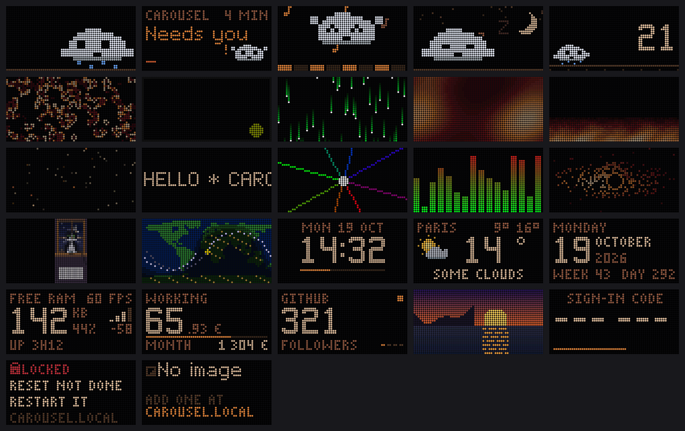
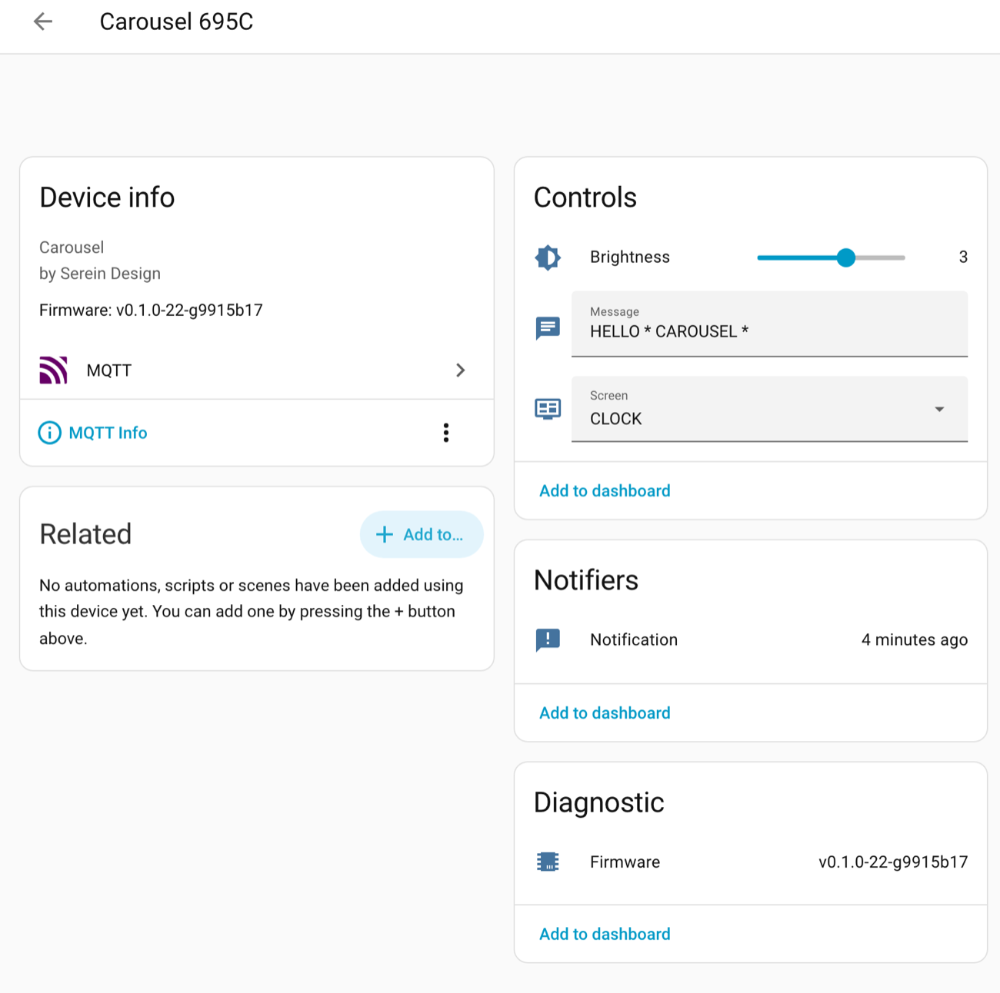

# Carousel

ESP32 firmware for a 64×32 HUB75 RGB LED panel: a gallery of pixel animations,
ambient info screens and a live status display for coding agent sessions, driven by a
rotary encoder and a tilt switch.

<p align="center"><a href="docs/tour.md"></a></p>

**[Product tour](docs/tour.md)**: every screen and web page with pictures.

> Unofficial project, not affiliated with or endorsed by Anthropic, OpenAI, Anysphere or
> Google. Claude and Claude Code are trademarks of Anthropic, PBC; Codex is a trademark of
> OpenAI; Cursor is a trademark of Anysphere, Inc.; Gemini is a trademark of Google LLC. The
> bridge only describes compatibility.

> **Status:** early development. The firmware works on the reference board; the
> codebase is being restructured (see [Roadmap](#roadmap)).

## Features

- **24 screens**: animations (Nimbus the cloud mascot, plasma, fire, Matrix, Game of Life, black hole,
  twinkling stars…) and utilities (clock, date, weather, system, earnings counter, YouTube /
  GitHub stats, ISS map) and IMAGE, your own GIFs.
- **Landscape and portrait**: a tilt switch rotates the panel between 64×32 and 32×64;
  each screen declares which orientations it supports.
- **Your screens, your order**: on the Running order page, turn each screen on or off and move it
  up or down; the knob, Home Assistant and the API follow that list. Each screen's own
  settings (message, city, salary, YouTube and GitHub, images) sit under it. The page refuses
  a list that leaves an orientation with no screen on.
- **Automatic rotation**: change screen every 10 s, 20 s, 30 s, 1, 2 or 5 minutes, or with the
  knob only (the default). Touching the knob or picking a screen from the API or Home Assistant
  pauses it: the next automatic change comes 30 s after the last touch at the earliest. A
  notification band across the top does not pause it; the count waits only while something
  covers the whole screen (an update, the sign-in code, the reach card). The rotation passes
  over IMAGE when no image
  is stored for the panel's orientation (the knob still reaches it), and writes nothing to
  flash: the screen remembered across restarts is the one on show at your last knob turn,
  remote screen choice or brightness change.
- **Coding agent bridge**: Claude Code, Codex CLI, Cursor and Gemini CLI push their session
  state to the panel, which animates what each is doing (thinking, using tools, waiting for
  you, idle) per session. One command from the Panel page sets a computer up: see
  [Coding agent bridge](#coding-agent-bridge).
- **Four web pages** at `http://carousel.local` (or the panel's own name, see
  [Its name on the network](#its-name-on-the-network)), opened with a code the panel shows:
  - **Stage** shows what the panel shows: a picture of its frame, refreshed every second while
    the page is visible (black while a sign-in code is on the panel: no page ever shows the
    code), the screen's name, its place and the next change, the screens coming next and the
    coding sessions. It acts in one tap: Bring on a screen, Brightness (dimmer, brighter) and
    Say something (the scrolling text).
  - **Running order**: the screen list, the rotation and each screen's own settings; SOCIAL's
    block shows the YouTube and GitHub counts.
  - **Images**: add, delete and choose your GIFs, each shown as itself.
  - **Panel**: language, Region (°C or °F, the currency, a 24 h or 12 h clock), night mode,
    Feedback (its own page: the transition between screens, what a brightness change or a
    knob turn shows, and for each kind of request Show, Discreet or Off), updates, Wi-Fi with
    the signal and its quality, and, folded under Advanced, Home Assistant, the coding agent
    hooks (the install command with its Copy button, the hook address, whether hooks need their
    token and Renew, Clear the session list), the local API token with Sign out every
    other browser, and memory and the last restart.

  Every action works with scripts off. The former Status lines moved: the signal to Panel's
  Wi-Fi, memory and the last restart to Advanced, the firmware row to Updates, the YouTube and
  GitHub counts to Running order, the sessions to Stage, the hook address and the install command to Panel's hooks.
  Without a known network the panel opens a `CAROUSEL-XXXX` access point (XXXX: shown on the
  panel) with a setup page, no reflash needed.
- **Your own images**: upload a GIF, still or animated, of 64×32 (landscape) or 32×64
  (portrait) from the Images page, a script or Home Assistant; it plays on the IMAGE screen
  with no restart, one image or all in turn. Up to 24 images, 96 KB each, kept through
  restarts and updates. Panels flashed before the final partition table need one
  [cable flash](#build-and-flash) for images; until then the page says they are not available.
- **Local API and MQTT**: switch screens, set the brightness, push a notification or the
  scrolling text, add and pick images from scripts; with a broker set, Home Assistant finds the panel by itself
  (MQTT discovery). See [`docs/api.md`](docs/api.md).
- **English and French**, on the panel and the web pages; pick the language on the Panel
  page. Adding a language is one table in
  [`firmware/src/i18n.cpp`](firmware/src/i18n.cpp); tests check it is complete and that
  every panel string fits the screen.
- **Weather** from [MET Norway](https://api.met.no/) (no API key, about once an hour), the
  city and its time zone from a table built from [GeoNames](https://www.geonames.org/) data
  (`data/places.bin`, read in pieces from this repository, suggested as you type), time over
  NTP with automatic DST. Weather data: MET Norway, places: GeoNames, both under
  [CC BY 4.0](https://creativecommons.org/licenses/by/4.0/).

## Its name on the network

A panel answers at `carousel.local`. When another device on the network already holds that
name, it answers at its own name instead, `carousel-xxxx.local`, where `xxxx` is the end of
its MAC address, the same four characters as its `CAROUSEL-XXXX` setup access point. The
pages' header and the long press on the knob show the name it answers at.

| Situation | Address to use |
| --- | --- |
| One panel | `http://carousel.local` |
| Two or more panels on one network | the first one up keeps `http://carousel.local`; each other one answers at its `http://carousel-xxxx.local` |
| `.local` does not open | the panel's IP address (Panel page, Wi-Fi; or a long press on the knob) |

Names ending in `.local` (mDNS) need the phone or computer and the panel to see each other's
multicast. They often fail on guest networks that keep devices apart, on some mesh routers,
with a VPN on the phone, and in older Android browsers. The IP address always works.

## Home Assistant

Set your MQTT broker on the Panel page (Advanced, Home Assistant) and Home Assistant finds it by itself
(MQTT discovery): pick the screen (among those that are on, in your order) and the image
shown, set the brightness and the scrolling message, send notifications from any automation,
see the firmware version. Without Home Assistant, the same controls are on the
[local API](docs/api.md).

<p align="center"></p>

```yaml
# In an automation: a message over the panel's screen for 10 s
action: notify.send_message
target:
  entity_id: notify.carousel_695c_notification
data:
  message: Washing machine done
```

### Images from Home Assistant

The **Image** picker chooses what the IMAGE screen shows: "All in turn" or one image. It
follows the images on the panel by itself.

```yaml
# In an automation: show one image
action: select.select_option
target:
  entity_id: select.carousel_695c_image
data:
  option: sunset.gif
```

Adding an image goes through the [local API](docs/api.md#post-apiimages) with the token,
never through MQTT. Home Assistant's `rest_command` sends text only, so the upload is a
`shell_command` running `curl`. Home Assistant writes the whole command to its log when it
fails, so the token is never on the command line: it stays in a file that `curl` reads
(`-H @file`), `/config/carousel.header`, holding one line:

```text
Authorization: Bearer <token>
```

```yaml
# configuration.yaml
shell_command:
  carousel_upload: !secret carousel_upload
```

```yaml
# secrets.yaml: the GIF to send, then the panel's address
carousel_upload: >-
  curl -sf -H @/config/carousel.header -F file=@/config/carousel/carousel.gif
  "http://carousel.local/api/images?show=1"
```

Keep the GIF outside `/config/www`: Home Assistant serves that folder at `/local/` to anyone,
without sign-in. Call the `shell_command.carousel_upload` action: the panel stores the GIF
(an image of the same name is replaced), adds it to the picker and shows it when its
orientation matches the panel's. `curl -f` makes
a refusal (not a GIF, wrong size, no room) fail the action; the reasons are listed in
[`docs/api.md`](docs/api.md#post-apiimages).

## Hardware

| Part | Notes |
| --- | --- |
| ESP32-WROOM DevKit (`esp32dev`) | |
| HUB75 P3 panel, 64×32, 1/16 scan | |
| Rotary encoder with push button | turn: change screen; short press: brightness; long press (0.8 s, a line fills at the bottom): the address and a QR code of the pages for 20 s; held at boot: Wi-Fi setup (3 s) or factory reset (10 s) |
| Tilt switch | on GPIO34 with an external 10 kΩ pull-up (GPIO34 has none) |
| 5 V power supply, 4 A minimum | **powers the panel directly** |

> ⚠️ Never power the panel from the ESP32's 5V/VIN pin or USB. Tie the supply ground
> to the ESP32 ground.

Pinout: see [`firmware/src/board.h`](firmware/src/board.h)
and the wiring diagram in [`docs/wiring.html`](docs/wiring.html). This repository
holds the firmware and its tools only; the board and enclosure files live elsewhere.

## Build and flash

Requires [PlatformIO](https://platformio.org/install/cli).

```sh
cd firmware
cp include/secrets.example.h include/secrets.h   # optional: Wi-Fi, time zone, location
pio run                                          # build
pio run -t upload                                # flash
pio device monitor                               # serial logs
```

The reference board has **no auto-reset circuit**: when esptool prints `Connecting`,
hold **BOOT**, tap **EN**, release **BOOT**. After flashing, tap **EN** to start.
Details in [`firmware/platformio.ini`](firmware/platformio.ini).

Once running, the serial console (`pio device monitor`) takes one letter then Enter: `x` reboots
the board without touching EN, `?` prints the panel timing settings.

### Updates for everyone: signed releases

Panels update themselves from this repository's GitHub releases, every night around 4 h
(release builds only; it can be switched off on the Panel page, under Updates, which also has
"Check for updates"). A release carries `firmware.bin` and a `manifest.json`; the panel installs an
image only if its ECDSA P-256 signature matches the public key built into the firmware and
its version is newer. A new image runs on trial: if it crashes before Wi-Fi and time are
up, the bootloader goes back to the previous one and that version is never retried.

Releasing: push a tag `vX.Y.Z`. The `release` workflow builds, signs with the
`UPDATE_SIGNING_KEY` secret (checked against the built-in public key first), and publishes
`firmware.bin`, `manifest.json` and a factory image for blank boards
(`esptool.py write_flash 0x0 carousel-vX.Y.Z-factory.bin`). On the serial console, `u` then Enter
checks and installs right away.

### Over-the-air updates for development

Set `OTA_PASSWORD` in `include/secrets.h`, flash once by cable, then:

```sh
pio run -e carousel-ota -t upload --upload-port <panel IP>
```

The password is read from `secrets.h` at upload time; the panel shows a progress bar
and reboots by itself. Without a password, OTA stays disabled.

### Panel test

`pio run -e hwtest -t upload` flashes a standalone panel test (colours, geometry, text,
scan) to check wiring before anything else.

`pio test -e native` runs the host-side unit tests (coding agent bridge state machine, JSON
parsing) on your computer, no board needed. CI runs them on every push.

## Coding agent bridge

The panel mirrors what your coding agents are doing, per session: Claude Code, Codex CLI,
Cursor and Gemini CLI. One command, copied from the Panel page, sets up the hooks of every
agent it finds on the computer. It needs a POSIX `sh`, curl 7.66 or later (for the scan
that finds the panel again) and a SHA-256 tool (`shasum`, `sha256sum` or `openssl`), which
every Mac and Linux has, and no npm or Node. Windows works through Git Bash or WSL, best effort.

1. Sign in to the panel, open Panel, and under Advanced open the coding agent hooks. Press
   Copy, or select the command, which looks like this (`<token>` is the panel's hook token,
   already in the command on the page):

   ```sh
   curl -sS --compressed --noproxy '*' "http://<panel IP>/install?k=<token>" | sh
   ```

2. Paste it in a terminal on a computer on the same network. It prints one line per agent:
   installed, not found, or to do by hand with the block to paste. An agent counts as
   installed when its command (`claude`, `codex`, `gemini`; `cursor` or `cursor-agent`, or
   the Cursor app on a Mac) is on the PATH: a config folder alone is not enough. For an
   agent not found, it removes the Carousel hooks an earlier run left in its file. It keeps your other
   settings and hooks, writes a `.carousel-backup` copy of each file before each change, and
   does nothing when run again. The quotes matter: zsh, the Mac's shell, refuses
   the address without them.
3. Codex CLI asks you to approve its new hooks once: type `/hooks` in Codex.
4. Start an agent. Its session shows on the CODE screen and on Stage.

What each agent reports:

| Agent | Idle | Thinking | Tool | Needs you | Failed tool | Error | Done |
| --- | --- | --- | --- | --- | --- | --- | --- |
| Claude Code | yes | yes | yes | yes | yes | yes | yes |
| Codex CLI | yes | yes | yes | yes | no | no | yes |
| Cursor | yes | yes | yes | no | yes | yes | yes |
| Gemini CLI | yes | yes | yes | yes | no | no | yes |

A Cursor session shows at its first prompt, not when it starts. Hooks store nothing on the
panel, and the panel needs no address: the hook follows it by name and address, and finds it
again when its IP changes (last known IP, then its own `carousel-xxxx.local`, then
`carousel.local`, the name a panel alone on its network answers at, then a scan of the local
network, only on a network where it has already seen the panel). Every address found must
name the panel in `/id` and prove it holds the token before it gets anything.

- **Several panels**: a computer follows the panel of the last command it ran. To follow
  another installed one, `export CAROUSEL_HOST=carousel-695c` (its name on the network, the end of its
  MAC as in its `CAROUSEL-695C` access point; `name` in `/id` gives it, with or without
  `.local`) in the shell the agent starts from.
- **The token**: every hook call carries the panel's hook token in a header, and the panel
  refuses a call without it (401) and changes nothing. Renew the token on the Panel page when
  a computer should stop; every other computer then runs the new command once. The command
  holds the token, so it stays in that terminal's shell history (and, while it runs, in the
  process list of the computer): Renew if someone else can read them. "Accept hooks
  without a token", off by default, restores the open behaviour for development. After a
  panel update that follows an older version, run the command once on each computer. The Panel
  page counts the refused calls and says so.
- **Uninstall**: `sh ~/.config/carousel/setup.sh uninstall` removes the hooks it added from
  every agent file, deletes the agent files it created and `~/.config/carousel`, and lists the
  `.carousel-backup` copies it leaves. It works without the panel.
- **Check**: `curl -H 'X-Hook-Token: <token>' "http://<panel IP>/agent/attention?s=test"` turns
  the CODE screen orange. Clear the test session on the Panel page (Advanced, coding agent
  hooks). The routes are in [`docs/api.md`](docs/api.md#hooks).

`/claude/<state>` and the French state names (`veille`, `reflex`...) still work, because
installed hooks send them.

The hook files live in `~/.config/carousel` (`XDG_CONFIG_HOME` if set); the agents' files
hold only the command that runs the hook, never the token.

## Repository layout

```text
firmware/
  src/             main firmware, one module per concern
    screens/       the gallery's screens
  hwtest/          standalone panel test
  test/            host-side unit tests and their Arduino stand-ins
tools/
  agent-bridge/    the hook and the installer served by the panel, and their tests
  pixelart/        GIF/PNG → RLE sprite converter for the firmware and simulator
  simulator/       Browser preview of the animations (open simulator.html);
                   selftest.mjs runs every example headless (CI)
  webcheck/        Browser checks of the web pages: overflow, 44 px targets,
                   contrast, axe (pages written by pio test)
docs/              Wiring guide
LICENSES/          Texts of the third-party licenses the firmware binary carries
NOTICE             Copyright holder and trademark reservation
```

## Roadmap

1. More languages (German first): one table in `firmware/src/i18n.cpp`.

## Contributing

See [CONTRIBUTING.md](CONTRIBUTING.md) (setup, tests, conventions) and the
[changelog](CHANGELOG.md). Security issues: [SECURITY.md](SECURITY.md).

## License

Copyright 2026 Serein Design ([NOTICE](NOTICE)). Released under the
[GNU Affero General Public License v3.0 only](LICENSE) (SPDX: `AGPL-3.0-only`).
Third-party components keep their own licenses: see
[THIRD_PARTY_NOTICES.md](THIRD_PARTY_NOTICES.md).

Serein Design, the se/de mark, Carousel and Nimbus are trademarks of Serein Design; the AGPL does
not grant rights to them.
