# Product tour

What Carousel is and does, with pictures, so you can see it without holding it.

Carousel is a 64×32 LED panel for your desk. It plays pixel animations, shows the time,
the weather and your own GIFs, and mirrors what Claude Code is doing. You run it from the
knob on the panel or from a web page on your phone. It runs on your home network;
it looks up the weather (MET Norway), the city and its time zone (a table built from
GeoNames data, read from this repository) and the time (NTP), and checks for signed updates.

Each screen image is drawn by the firmware's own screen code, as LEDs, with fixed inputs
(14:32 on a Monday, Paris weather, made-up counters and sessions). They show what each
screen holds; the real panel is brighter and moves.

## The panel

On the desk: the LED panel, with a rotary knob and a tilt switch. The knob does three things.

- **Turn** it to change screen. Only the screens you left on, in your order. What a turn
  shows (a band with the screen's name and place, its neighbours, dots, or nothing) is your
  choice on the [Feedback page](#feedback).
- **Press** it to change the brightness. The press counts when you let go. On the CODE
  screen with several Claude Code sessions, a press moves to the next session instead. At
  night the first press only wakes the panel for a minute.
- **Press and hold** it for 0.8 s with the panel running: a line fills along the bottom
  while you hold, then the [reach card](#the-reach-card) opens.
- **Hold** it while you plug the panel in. Let go before 3 seconds: Wi-Fi setup
  (see [Setup from the box](#setup-from-the-box)). Keep holding past 3 seconds and the
  panel turns red and counts down to a factory reset at 10 seconds; let go before then to
  cancel.

The tilt switch turns the picture: stand the panel on its side and it plays the portrait
screens at 32×64. Each screen declares which orientations it supports.

### The reach card

A long press opens a card with the address of the pages, then a QR code and the IP address,
for 20 s or until the knob moves. The pages' header shows the same name:
`carousel.local`, or `carousel-xxxx.local` (the end of the panel's MAC) when another panel
on the network already holds the first one.

### When it starts

On power-up the se/de mark fades in and gives way to the word Carousel, with a thin line
that fills while the panel gets ready. The first screen then opens from the centre like a
stage curtain. If a step fails, the line stops in the alert colour and the panel opens that
step's state screen. After a software restart (an update, say) the mark is skipped and the
boot starts at the word. On Panel, under Advanced, Boot screen picks Simple (the line only),
Detailed (the IP address under it) or Auto (Detailed on a development build).

### The status strip

On the screens that follow the panel's grid (CODE, CLOCK, WEATHER, DATE, SYSTEM, MONEY,
SOCIAL and TEXT), the bottom row is a status strip. A one-pixel line fills from the left over
the time until the next screen. It is absent when the rotation is off or has nowhere to go,
and it disappears for 30 s after a touch or a request, while the rotation waits. At its
right end a two-pixel mark shows your coding agents: in the accent colour when a session
needs you, dim while one works, nothing otherwise. CODE keeps the line but not the mark. The
screens drawn as full pictures keep their bottom row.

### Messages

A message sent through the API or Home Assistant crosses the top of the panel as a band,
scrolls its text twice and slides away, while the screen keeps running below it. Without a colour it uses the
panel's text colour. The [Feedback page](#feedback) can reduce it to a small chip or to
nothing.

## Every screen

24 screens, in the order the firmware ships them. BALL, MATRIX, RAYS and BARS are off on a
panel that never saved a list; turn them on by hand. You choose which ones play and in what
order on the [Running order page](#running-order).

| Screen | What it shows |
| --- | --- |
| 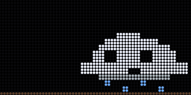 | **NIMBUS**: the cloud mascot walks across the panel, waves at the edge and jumps now and then. |
|  | **CODE**: your Claude Code sessions, as the mascot at its keyboard or as a list. Landscape only. Styles: Auto, Cloud, List. See [the coding-agent view](#the-coding-agent-view). |
| 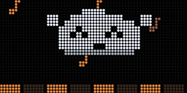 | **DANCE**: the mascot dances on a floor that lights up, with notes rising. |
| 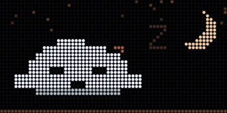 | **SLEEP**: the mascot sleeps under the moon and the stars, its Zs rising. Landscape only. |
| 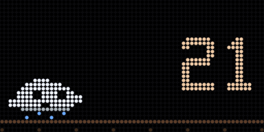 | **RUN**: the mascot runs and jumps, with a score counting up. A crash says BUG! over your best score. Landscape only. |
| 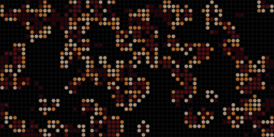 | **LIFE**: Conway's Game of Life, a calm ambiance: beige cells, orange births, an ember trail, a new seed every 30 s. |
| 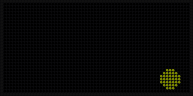 | **BALL**: a ball moving around the panel. Off in the default list. |
| 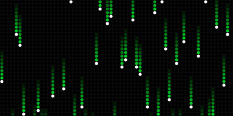 | **MATRIX**: green trails falling. Off in the default list. |
| 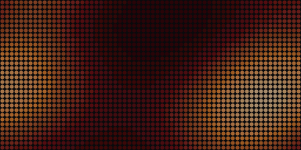 | **PLASMA**: a slow plasma, like ink spreading in water: an ambiance. |
| 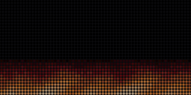 | **FIRE**: embers in the lower third with a spark now and then: an ambiance. |
| 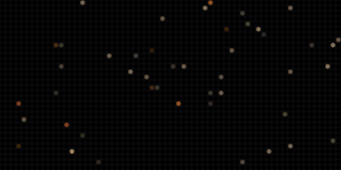 | **STARS**: beige and orange stars that twinkle, with a shooting star about every 20 s: an ambiance. |
| 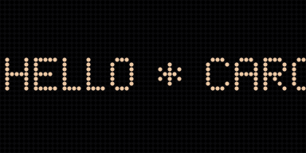 | **TEXT**: a message crossing the panel from right to left, in the text colour. It starts as `HELLO * CAROUSEL * `. Landscape only. Setting: the message, also set from Stage's Say something. |
| 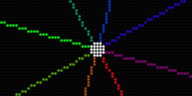 | **RAYS**: rays turning around a centre. Off in the default list. |
| 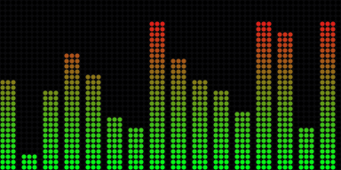 | **BARS**: moving level bars. Off in the default list. |
| 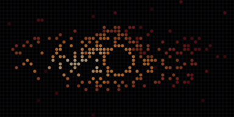 | **BLACKHOLE**: a black hole and its disc turning around it, a star drawn in now and then: an ambiance. |
| 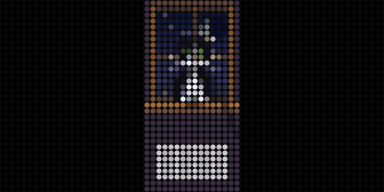 | **CAT**: a tuxedo cat on a window ledge at night. It blinks, yawns and falls asleep. Portrait only. |
| 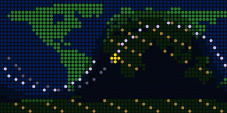 | **ISS DEMO**: a world map with the International Space Station's track and the night creeping across. The orbit is simulated, not the real station, so the screen says DEMO. |
|  | **CLOCK**: the time in big digits, 24 h or 12 h with AM or PM. Styles: Stone, Dial, Alternate; it can also show the date, a seconds line, the week number and the outside temperature. Time over NTP, daylight saving handled. Until the time is known it shows dashes. |
|  | **WEATHER**: the sky and the temperature in °C or °F, from [MET Norway](https://api.met.no/) (no API key, about once an hour). Styles: Glance, Scene, Day. Setting: your city, found with [GeoNames](https://www.geonames.org/); the time zone, daylight saving included, and the ISS distance follow it. Weather: MET Norway (CC BY 4.0) · Places: GeoNames (CC BY 4.0). If the reading is old, it stays dimmed with the reason in a foot band. |
| 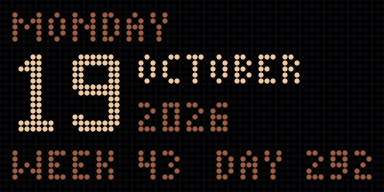 | **DATE**: the weekday, the day of the month in big digits with the month and year beside it, the week and the day of the year. |
| 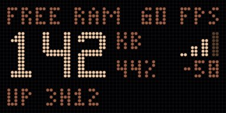 | **SYSTEM**: free memory with its share, time since the last restart, the Wi-Fi signal in bars and dBm, and the frame rate. |
| 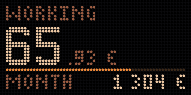 | **MONEY**: an earnings counter that goes up live during working hours: the day's earnings in the chosen currency with the cents, a line for the working day and the month's total. Settings: net monthly salary, when the day starts and ends, days per month. |
| 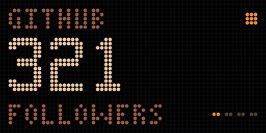 | **SOCIAL**: follower counts, one at a time, the next pushing it up every 4 s. YouTube (with your API key and channel) and GitHub (a user name, no key) fetch themselves; Instagram and X are numbers you type in. A filled dot says the number comes from an API, a hollow one that you typed it. Old counts stay dimmed with the reason in a foot band. |
| 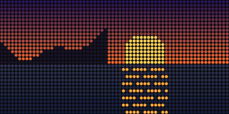 | **IMAGE**: your own GIFs, one or all in turn. See [Images](#images). The picture here is a stand-in sunset. |

Panel messages the owner may meet:

| Frame | When |
| --- | --- |
| 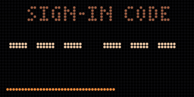 | **Sign-in code**: a web page asked for a code. Six large digits in two groups of three, with a line that shortens as the code runs out. They show on the panel only (here as dashes), never on any page, and last 2 minutes. |
| 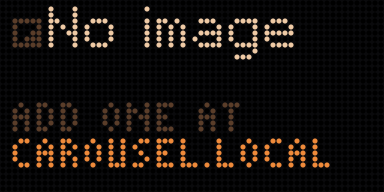 | **No image**: IMAGE has no GIF stored. It says how to add one, with the panel's address in the accent colour. |
| 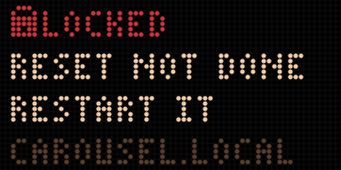 | **Locked**: a factory reset did not finish. The panel says RESET NOT DONE, RESTART IT; the reset resumes at the next start. |

## Screen styles

CODE, CLOCK and WEATHER each come in several styles. Pick one on the screen's own page: in
[Running order](#running-order), the gear on its row opens it. The row's picture follows the
style.

| Screen | Style | What it looks like |
| --- | --- | --- |
| CODE | Auto | The cloud for one or two sessions, the list from three. |
| CODE | Cloud | 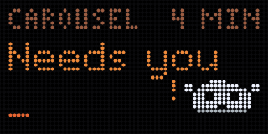 The mascot, the state in a word, the project and the time. |
| CODE | List | 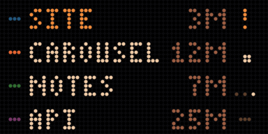 One row per session, up to four; the one that needs you in orange. |
| CLOCK | Stone | 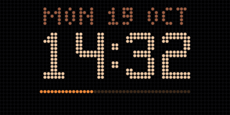 Big digits, the date above, the seconds as a line. |
| CLOCK | Dial | 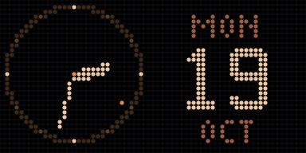 A dial with hands, the date beside it. |
| CLOCK | Alternate | 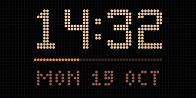 Big digits, one line below that changes every 4 s. |
| WEATHER | Glance | 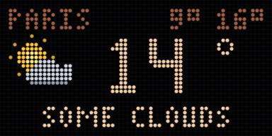 Icon, temperature, conditions, low and high. |
| WEATHER | Scene | 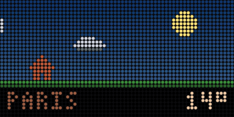 Today's illustrated scene, the temperature small. |
| WEATHER | Day | 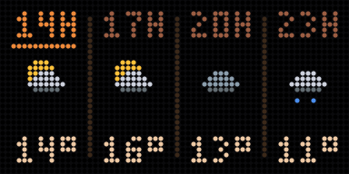 Now and the next three slots: hour, icon, temperature. |

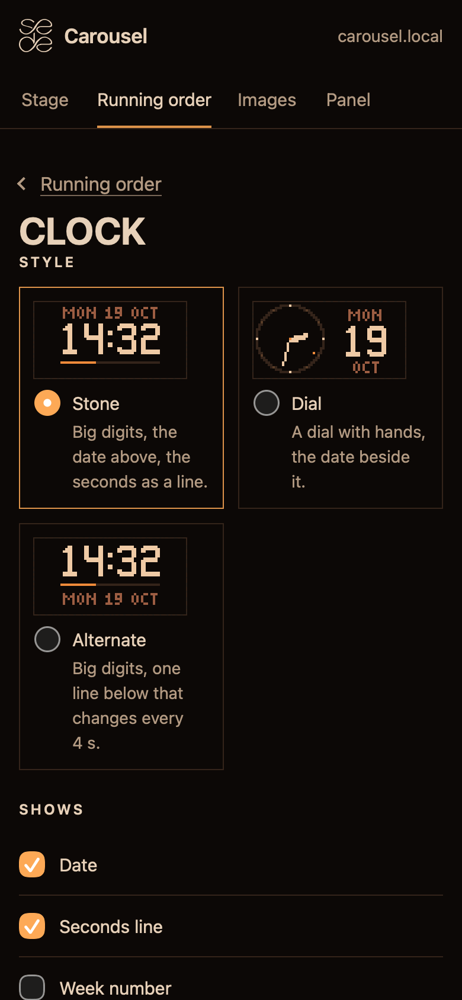

CLOCK's page also lists what the clock shows: the date, a seconds line, the week number and
the outside temperature.

## The coding-agent view

The CODE screen mirrors Claude Code, one session at a time. The mascot sits at its
keyboard, with a bar on top for the sessions the panel hears from (up to six, each
with its own tint). What you see:

- **Idle**: slumped over the keyboard.
- **Thinking**: working it out.
- **Using a tool**: typing, with code scrolling in a terminal.
- **Needs you**: turns towards you and waves its arms, when the agent waits for your answer.
- **Error**: knocked out.
- **Done**: celebrates with "OK!".
- **Failed**: startled.

Stage lists the sessions and their state too. A session closed without its end signal
stays listed for 15 minutes; Panel's Advanced block has Clear the session list. Setting
up the hooks takes two steps: see [Coding agent bridge](../README.md#coding-agent-bridge).
Claude Code is named for compatibility only; this is an unofficial project.

## The web pages

Open `http://carousel.local` in a browser on the same network. The pages are in English
and French; the se/de mark sits in their header. Every action works with scripts off. They
open with a code the panel shows.

### Stage

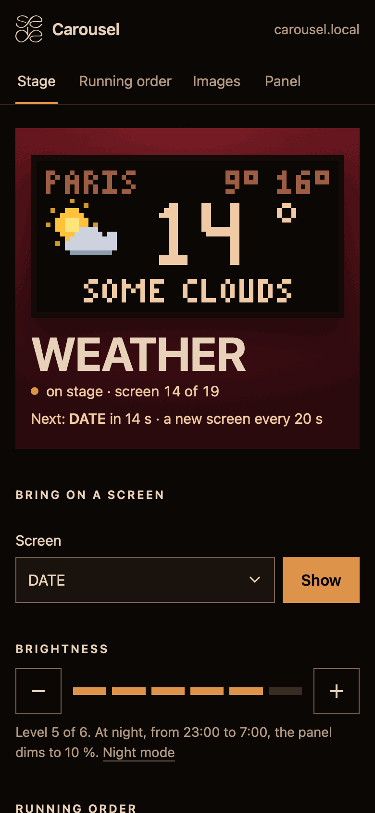

What the panel shows right now: a picture of its frame (refreshed every second while the
page is visible), the screen's name, a line with an orange dot that says it is live ("on
stage · screen 14 of 19"), when the next change comes and the screens coming up. You can act in one tap: **Bring on a screen** to pick one,
**Brightness** to go dimmer or brighter, **Say something** to send the scrolling text.
The coding sessions are listed here too.

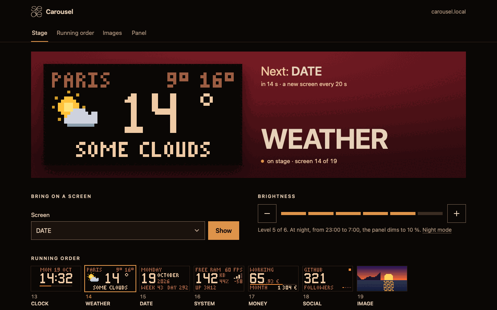

### Running order

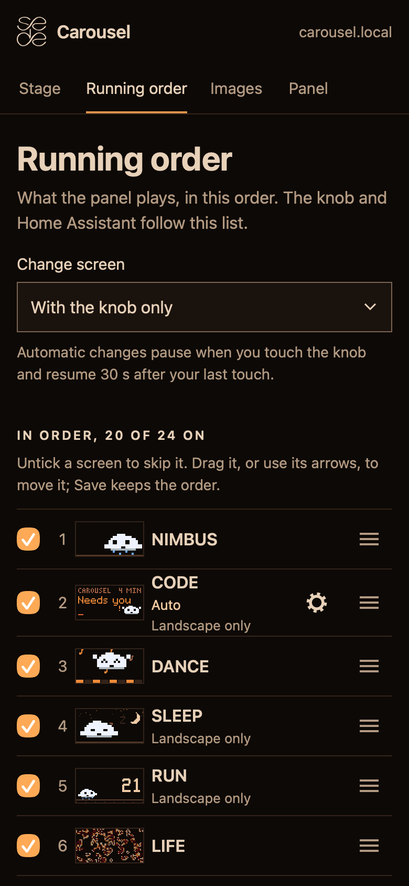 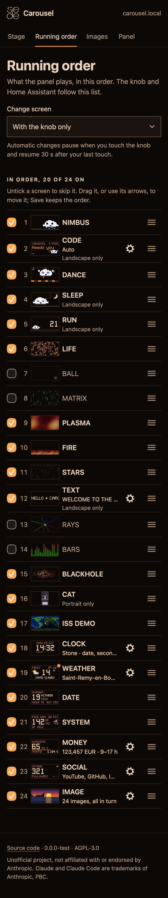

What the panel plays, and in what order. Untick a screen to skip it, move it with the
arrows, then Save. The knob, Home Assistant and the API follow this list. A gear on the row
of CODE, CLOCK, WEATHER, TEXT, MONEY, SOCIAL and IMAGE opens that screen's own page: its
style, message, city, salary, YouTube and GitHub, or the image shown. The page refuses a
list that leaves an orientation with no screen on. The rotation changes screen every 10 s,
20 s, 30 s, 1, 2 or 5 minutes, or with the knob only, the default. Touching the knob
pauses it for 30 s.

### Images

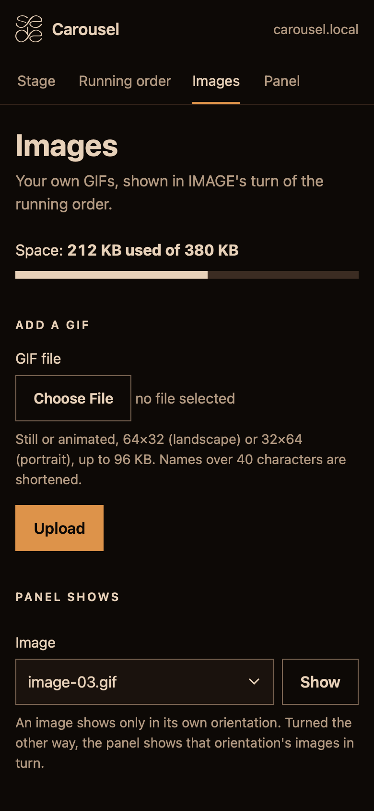

Your own GIFs, shown on the IMAGE screen. Add one (still or animated, 64×32 for landscape
or 32×64 for portrait, up to 96 KB), delete it, or choose which one the panel shows, or
all in turn. Up to 24 images, kept through restarts and updates.

### Panel

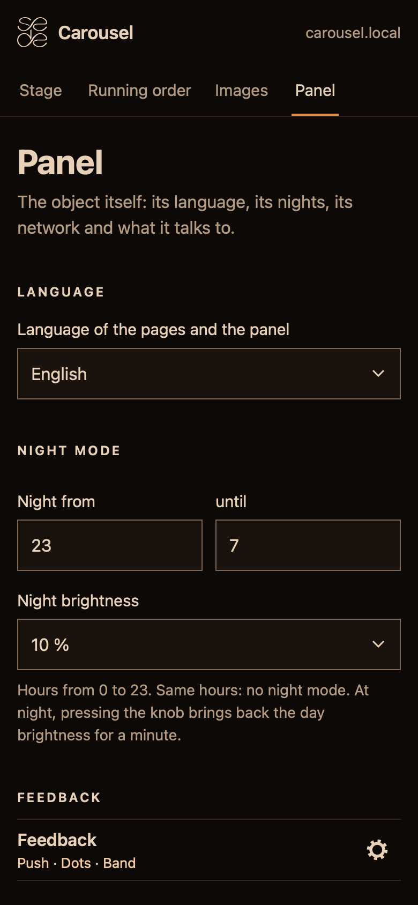

The object itself. Language (English or French), Region (the temperature in °C or °F,
the currency MONEY counts in, a 24 h or 12 h clock), night mode (the hours and how dim),
Feedback, updates, and Wi-Fi with its signal. Folded under Advanced: Home Assistant, the
Claude Code hooks, the local API token with Sign out every other browser, memory and the
last restart, and the boot screen.

### Feedback

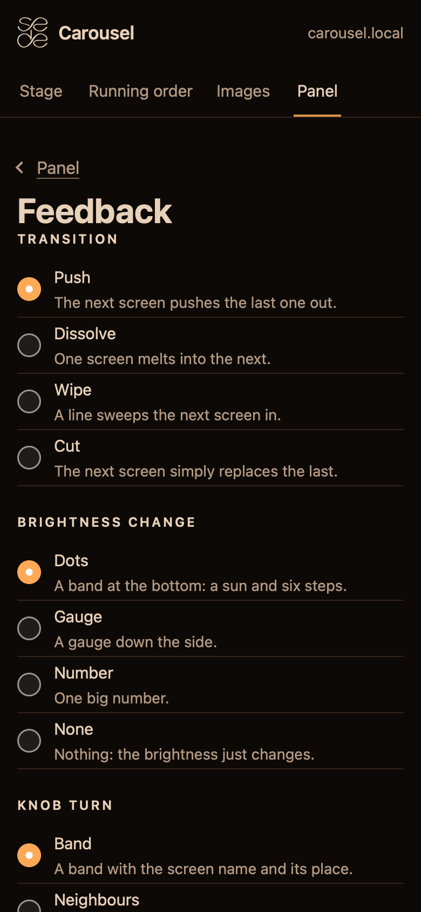

How the panel answers you, from the Feedback row on Panel (the gear). It sets:

- **Transition** between screens: Push, Dissolve, Wipe or Cut.
- **Brightness change**: Dots (a band at the bottom), Gauge, Number or None.
- **Knob turn**: Band, Neighbours, Dots or None.
- **Requests**, for each of Messages, Images, Commands and Coding agent: Show (in its own
  way: a band, the full screen or a chip), Discreet (a small chip in a corner) or Off (only
  the change itself).

A coding agent that needs you brings CODE on stage with the chosen transition.

### Wi-Fi setup

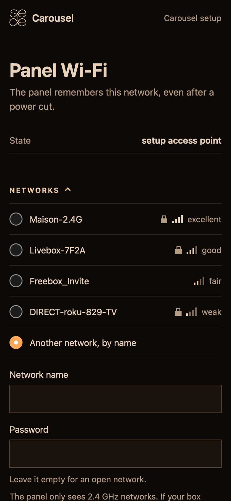

Pick your network from the list, or type its name, add the password and Continue. The
panel restarts and joins it. It sees 2.4 GHz networks only. The names in this picture
are made up.

The phone also hands the panel its time zone, for a first city, and its region and clock,
for °C or °F, the currency and 12 h or 24 h. A choice already made on Panel stays.

### Sign-in

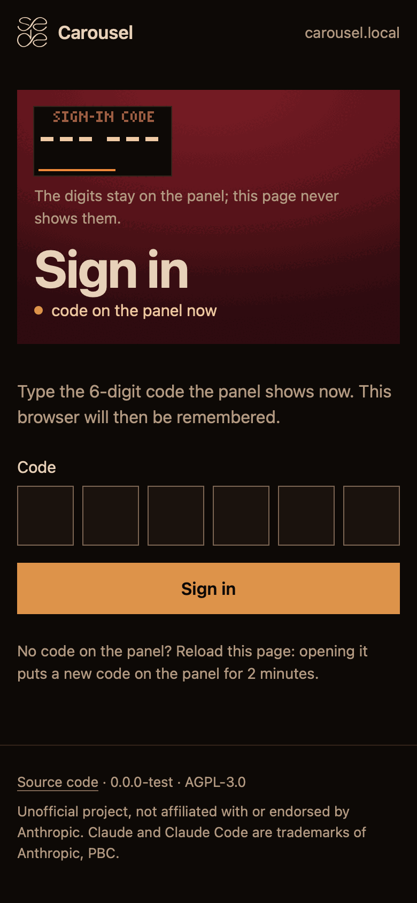

Type the six digits the panel shows, in the six boxes. The browser is then remembered.
No code on the panel? Reload the page: opening it puts a new one there for 2 minutes.

### When something is wrong

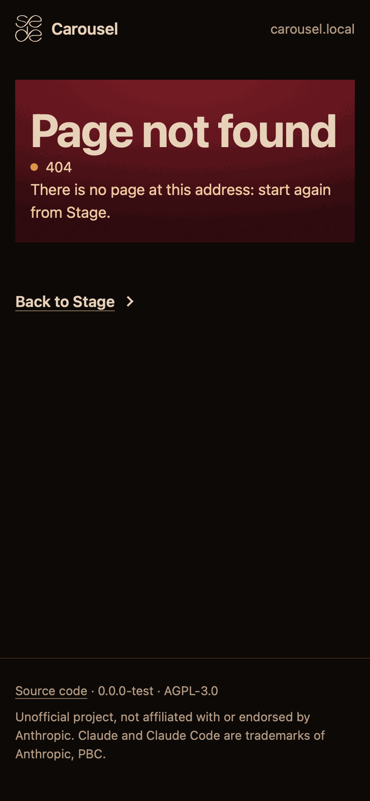

Error pages say what happened in a sentence and give you a way back to Stage.

## Setup from the box

1. Power the panel with a 5 V supply (4 A or more).
2. With no known network, it opens its own Wi-Fi, named `CAROUSEL-XXXX`. The four
   characters show on the panel.
3. Join that network from your phone. The Wi-Fi setup page opens by itself; if it does
   not, go to `192.168.4.1`.
4. Pick your home network and type its password. The panel restarts and joins it.
5. Open `http://carousel.local` and type the code the panel shows. You are on Stage.

To redo it later, hold the knob while plugging the panel in (see [The panel](#the-panel)).
The Wi-Fi page also shows the signal strength once the panel is connected. Build and flash
steps for the firmware itself are in the [README](../README.md#build-and-flash).

## Home Assistant

Set your MQTT broker on Panel's Advanced block and Home Assistant finds the panel by
itself: the screen, the image, the brightness, the scrolling message, notifications and the
firmware version. See [Home Assistant](../README.md#home-assistant) in the README.

## The local API

Scripts can switch screens, set the brightness, push a notification or the scrolling text
and add images, with the token from the Panel page. See [`api.md`](api.md).

## What it does not do

- No cloud service of ours and no account: the panel talks to your network.
- The pages never show the sign-in code: it stays on the panel.
- The Claude Code hooks speak to the panel directly, on your network.
- Not an official Anthropic product.
